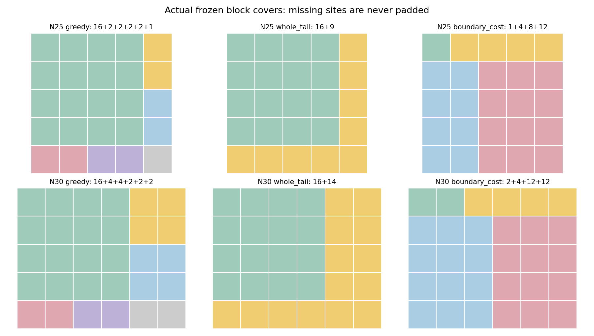
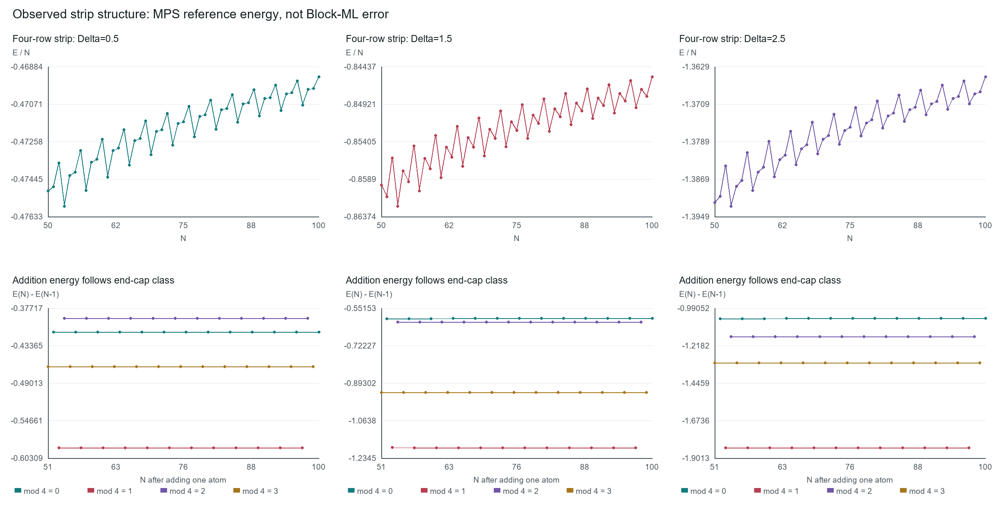

# Results and Evidence Limits

[Back to the project overview](README.md)

Prepared on 23 October 2026 from saved research records through 14 September 2026. No experiment was rerun to produce this public overview. Values are rounded from the underlying reports; no new statistical-significance claim is made.

## 1. Fixed-Rule Transfer on Four-Row Arrays

Completed 10 September 2026. Source run identifier: `run_20260909_transfer_v1`.

- 18 physical configurations: N in {28, 29, 30, 31, 37, 38}, each at Delta in {0.5, 1.5, 2.5}.
- Omega = C6 = spacing = 1, full distance-dependent r^-6 interactions.
- At most 16 atoms in a local exact block and five fixed CMF starting states.
- No refitting: prediction was `E_CMF - beta * cut_strength` with beta fixed at 0.013940877116561988.
- The references had previously been used for development. This was not an untouched test.

| Partition policy | Total-energy MAE | Maximum absolute error | Mean absolute error per atom |
|---|---:|---:|---:|
| Large-block-first greedy remainder | 0.02651336 | 0.07358488 | 0.0008522300 |
| Connected whole remainder | 0.01473709 | 0.06382333 | 0.0004736104 |
| Cost-aware rectangular partition | 0.01706310 | 0.05783968 | 0.0005404683 |

The connected-remainder MAE improvement was 44.416%. It improved 14 cases and worsened four; it was not a pointwise improvement guarantee. Per-atom MAE means the average of each configuration's absolute total-energy error divided by its own N.

## 2. Prospective Two-Edge Shape Pilot

Completed 10 September 2026. Source run identifier: `run_20260910_lshape_v1`.

Six physical configurations: 5x5 and 5x6, each at the same three Delta values. Six new approximate MPS references passed the run's numerical checks. Predictions used fixed rules, five starting states and the same beta as above. This was a prospective development-shape pilot, not the original final test.

| Partition policy | Uncorrected CMF MAE | Corrected total-energy MAE | Maximum corrected absolute error |
|---|---:|---:|---:|
| Greedy remainder | 0.22242340 | 0.01915820 | 0.04610948 |
| Whole L-shaped remainder | 0.15118180 | 0.02259741 | 0.05609176 |
| Cost-aware rectangular partition | 0.18349603 | 0.01972415 | 0.05806641 |

Whole-remainder CMF MAE improved 32.03%, while corrected MAE worsened 17.95%. In the 5x5 subset corrected MAE improved, but in the 5x6 subset it worsened for all three Delta values. Both candidate policies failed the pilot's joint average/worst-case accuracy criterion.

For a fixed coefficient, the change in predicted energy can be decomposed as:

```text
E_pred(candidate) - E_pred(greedy)
  = -[E_CMF(greedy) - E_CMF(candidate)]
    + beta * [cut_strength(greedy) - cut_strength(candidate)]
```

Changing a partition changes both the physical baseline and the correction magnitude. This identity explains how an improvement in one can be offset by the other; it is bookkeeping, not a newly established physical law.



## 3. External Reference-Workbook Audit

Analysis completed 14 September 2026. Source run identifier: `run_20260914_workbook_v1`.

| Workbook status | Configurations |
|---|---:|
| Qualified according to the workbook | 212 |
| Unconverged | 196 |
| Failed | 7 |
| Cloud-qualified, awaiting review | 2 |
| Protected / withheld | 6 |
| Total | 423 |

There are 408 numerical energies, but these must not be confused with 408 qualified references. The 212 qualified labels cover 75 distinct atom counts and 94 geometries. All 153 four-row configurations from N50 to N100 at the three Delta values are labelled qualified. At N150, only the 5x30, Delta=0.5 case is qualified in this workbook.

The analysis checked arithmetic, unique configuration identifiers/hashes, agreement between sheets, and agreement of all 212 qualified energies with the lowest recorded same-Hamiltonian chi128 stage energies. Nine arithmetic, geometry and split-exclusion checks passed. The original workbook was unchanged.

This was an internal consistency audit, not an independent verification of the external Hamiltonian implementation or saved MPS states. Agreement between chi64 and chi128 is a convergence diagnostic, not a rigorous bound on exact ground-state error. No protected labels were used.

### Finite-Size Structure

For each Delta, 47 four-row pairs were used to calculate `E(N)-E(N-4)`:

| Delta | Mean full-column energy increment | Standard deviation across sizes |
|---:|---:|---:|
| 0.5 | -1.858754407 | 1.92687e-7 |
| 1.5 | -3.337533297 | 3.42280e-5 |
| 2.5 | -5.377868361 | 4.03301e-5 |

The standard deviations describe variation across overlapping size pairs, not independent sampling uncertainty or absolute reference precision. The four-site cycle corresponds to this geometry's construction; it is not evidence for a four-site quantum ordered phase.



An exploratory five-coefficient formula, `E = a*N + b_endcap`, was fitted on N50-75 and assessed on N76-100 separately at each Delta. Its per-atom MAEs were 1.02065e-8, 1.48442e-6 and 2.24580e-6. The features were proposed after inspecting the workbook, so this was **post-hoc analysis, not blind validation**. These are not results for the Block-ML model and do not establish accuracy relative to exact energies.

### Width Matters As Well As Atom Count

At Delta=0.5, the qualified 5x30 (N150) case has a reported chi64/128 difference per atom of 4.13517e-9. The unqualified 7x7 (N49) case has 7.71591e-7. This disproves a simple monotonic ordering of this protocol's difficulty by N alone, without establishing a general complexity law.

## Interpretation and Reproducibility Status

- All reported energy comparisons are numerical simulations, not laboratory measurements.
- The strip and two-edge comparisons use different panels and cannot be combined into one headline accuracy claim.
- Fixed-width scaling is not the two-dimensional thermodynamic limit.
- Source code, raw references, split manifests and saved states remain outside this intentionally limited public overview. The overview alone is insufficient for independent reproduction.
- Before submission, the method needs prospective geometry/parameter tests, matched baselines, reference-quality audits and a separately prepared reproducibility release.
